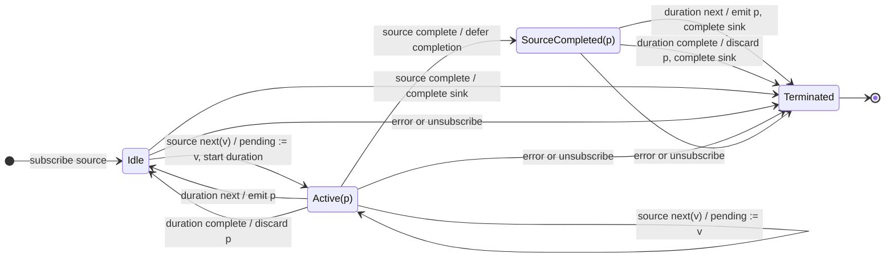

# audit

## Semantic essence

`audit` maintains one pending source value while a non-restarting duration is active. The first value received while idle becomes pending and starts a duration. New source values during that duration replace the pending value without restarting the duration. When the duration emits, the current pending value is emitted and the operator returns to idle.

## Classification

- Policy: trailing temporal admission
- Memory: one pending value
- Boundary: duration Observable created from the first value while idle
- Boundary restart: no
- During boundary: replace pending
- Release: duration emission

## Core BDD

```text
Given audit is idle
When a source value arrives
Then admit the source value as the pending value
And start a duration for that value

Given a duration is active with a pending value
When a new source value arrives
Then replace the pending value with the new source value
And keep the active duration running
And do not start another duration
And emit nothing to the sink

Given a duration is active with a pending value
When the duration emits
Then unsubscribe the active duration
And emit the pending value to the sink
And clear the pending value
And return to idle
```

## Mealy machine



## Marble model

```text
source       ^-- a -- x -- y ---------- b -- x ----------|
pending          a -> x -> y            b -> x
duration 1       ^----------!               
duration 2                           ^----------!
sink         ^--------------y------------------x----------|
```

## Lifecycle

- Source completion while idle completes immediately.
- Source completion with an active duration defers completion until that duration resolves.
- Duration completion without emission drops the pending value.
- Error discards pending state and terminates immediately.
- Downstream unsubscription cancels source and active duration and discards pending state.

## Business interpretation

Coalesce rapidly changing business state into the latest value released at a non-restarting boundary, for example rate-limited API refresh intentions.

## Domain DSL

```ts
function requestEvery<T>(everyMs: number): MonoTypeOperatorFunction<T> {
  return audit(() => timer(everyMs));
}
```

Meaning: do not create requests periodically; instead, release the latest pending request at the end of each source-triggered non-restarting interval.

## Semantic fingerprint

**retain latest + keep boundary + trailing release**
