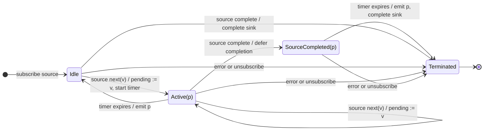

# auditTime

## Semantic essence

`auditTime` maintains one pending value while a fixed non-restarting timer is active. The first value while idle starts the timer. New values replace the pending value but do not restart the timer. Timer expiry emits the latest pending value and returns the operator to idle.

## Classification

- Policy: trailing temporal admission
- Memory: one pending value
- Boundary: fixed timer
- Restart: no
- During timer: replace pending
- Release: timer expiry

## Core BDD

```text
Given auditTime is idle
When a source value arrives
Then retain it as pending
And start the fixed audit interval

Given the audit interval is active
When a new source value arrives
Then replace the pending value
And keep the current interval running
And emit nothing

Given a pending value exists
When the audit interval expires
Then emit the pending value
And return to idle
```

## Mealy machine



## Marble model

```text
source       ^-- a -- x -- y ---------- b -- x ----------|
pending          a -> x -> y            b -> x
timer 1          ^----------!
timer 2                              ^----------!
sink         ^--------------y------------------x----------|
```

## Business interpretation

Release the latest pending refresh or state update after a fixed source-triggered interval.

## Domain DSL

```ts
function requestEvery<T>(everyMs: number): MonoTypeOperatorFunction<T> {
  return auditTime(everyMs);
}
```

## Semantic fingerprint

**retain latest + fixed non-restarting timer + trailing release**
