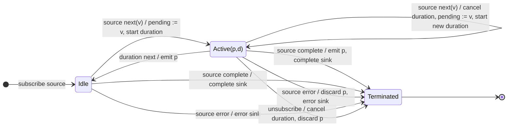

# debounce

## Semantic essence

`debounce` maintains one pending value and a corresponding duration. Every new source value replaces the pending value, cancels the previous duration, and starts a new duration for the new value. The pending value is emitted only when its current duration emits before another source value arrives.

## Classification

- Policy: stabilization
- Memory: latest pending value
- Boundary: duration Observable selected per value
- New value: replace pending and replace boundary
- Release: current duration emission

## Core BDD

```text
Given debounce is idle
When a source value arrives
Then retain it as pending
And start a duration for it

Given a pending value exists with an active duration
When a new source value arrives
Then cancel the active duration
And replace the pending value
And start a new duration
And emit nothing

Given a pending value exists with an active duration
When the duration emits
Then emit the pending value
And return to idle
```

## Mealy machine



## Marble model

```text
source       ^-- a --- x --- y --------------------------|
pending          a ->  x ->  y
duration a       ^---x
duration x             ^---x
duration y                   ^--------!
sink         ^-------------------------y-----------------|
```

## Lifecycle

Completion flushes a pending value before completing. Error discards it. Unsubscription cancels the active duration.

## Business interpretation

Wait for an intention or state to stabilize before acting, such as adaptive search input validation.

## Domain DSL

```ts
const afterStable = debounce;
```

## Semantic fingerprint

**retain latest + replace boundary + release after stabilization**
