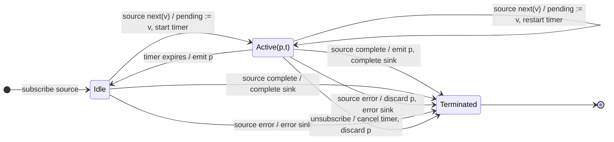

# debounceTime

## Semantic essence

`debounceTime` retains the most recent source value and restarts a fixed silence timer on every new value. The pending value is emitted only after the source remains silent for the configured duration.

## Core BDD

```text
Given debounceTime is idle
When a source value arrives
Then retain it as pending
And start the silence timer

Given a pending value exists and the silence timer is active
When a new source value arrives
Then replace the pending value
And restart the silence timer
And emit nothing

Given a pending value exists
When the silence timer expires
Then emit the pending value
And return to idle
```

## Mealy machine



## Marble model

```text
source       ^-- a --- x --- y --------------------------|
pending          a ->  x ->  y
timer a          ^---x
timer x                ^---x
timer y                      ^--------!
sink         ^-------------------------y-----------------|
```

## Business interpretation

Search-as-you-type: wait until input has remained unchanged for a fixed duration before issuing the HTTP search.

## Domain DSL

```ts
function afterStableFor<T>(ms: number): MonoTypeOperatorFunction<T> {
  return debounceTime(ms);
}
```

## Semantic fingerprint

**latest value + restarting fixed timer + release after silence**
