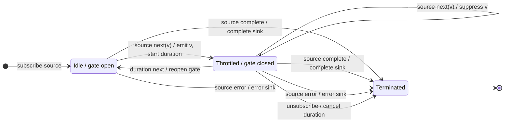

# throttle

## Semantic essence

With the default leading-only configuration, `throttle` emits the first source value while the admission gate is open, starts a non-restarting duration, suppresses source values while that duration is active, and reopens the gate when the duration signals.

## Classification

- Policy: leading temporal admission
- State: gate open/closed plus active duration
- Default edge policy: leading true, trailing false
- During closed gate: suppress
- Duration restart: no

## Core BDD

```text
Given throttle is idle
When a source value arrives
Then emit it immediately
And start a duration
And close the admission gate

Given a duration is active
When a new source value arrives
Then suppress the source value
And keep the duration running

Given a duration is active
When the duration emits
Then reopen the admission gate
And return to idle
```

## Mealy machine



## Marble model

```text
source       ^-- a -- x -- y ---------- b -- x -- y -----|
gate            CLOSED ------ OPEN ---- CLOSED ------ OPEN
duration 1      ^----------!
duration 2                           ^----------!
sink         ^-- a ------------------ b ------------------|
```

## Configuration insight

Trailing mode requires retaining the latest source value during the closed interval. Therefore configuration can change the operator's required internal state.

## Business interpretation

Admit an expensive command immediately, then suppress repeat intentions until a dynamic protection duration ends.

## Domain DSL

`admitThenSuppress(durationSelector)`

## Semantic fingerprint

**leading admit + close gate + suppress + non-restarting boundary**
