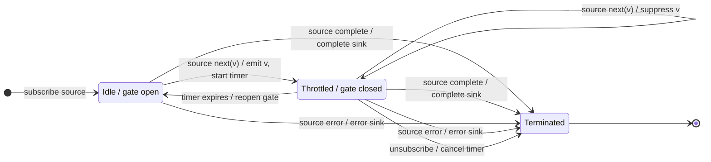

# throttleTime

## Semantic essence

With the default leading-only configuration, `throttleTime` emits the first source value while idle, closes the admission gate for a fixed non-restarting interval, suppresses intervening values, and reopens the gate when the timer expires.

## Core BDD

```text
Given throttleTime is idle
When a source value arrives
Then emit it immediately
And start the fixed throttle interval
And close the admission gate

Given the throttle interval is active
When a new source value arrives
Then suppress it
And keep the timer running

Given the throttle interval is active
When the timer expires
Then reopen the gate
And return to idle
```

## Mealy machine



## Marble model

```text
source       ^-- a -- x -- y ---------- b -- x -- y -----|
gate            CLOSED ------ OPEN ---- CLOSED ------ OPEN
timer 1         ^----------!
timer 2                              ^----------!
sink         ^-- a ------------------ b ------------------|
```

## Business interpretation

Accept the first report-generation command immediately and suppress repeats for a configured protection interval.

## Domain DSL

```ts
function admitThenSuppressFor<T>(ms: number): MonoTypeOperatorFunction<T> {
  return throttleTime(ms);
}
```

## Semantic fingerprint

**leading admit + fixed non-restarting gate + suppress remainder**
