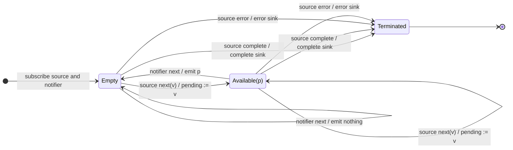

# sample

## Semantic essence

`sample` retains the latest source value received since the previous sampling event. Source values only update the retained candidate. An independent notifier controls when sampling occurs. A notifier emission emits the pending latest value if one exists and clears its availability; if no fresh source value exists, the notifier produces no sink emission.

## Classification

- Policy: external observation
- Memory: latest unsampled value
- Boundary ownership: independent notifier
- Source starts/restarts boundary: no

## Core BDD

```text
Given no value is pending for sampling
When a source value arrives
Then retain it as the pending sample

Given a source value is pending
When another source value arrives
Then replace the pending sample

Given a source value is pending
When the notifier emits
Then emit the pending latest value
And clear the pending sample

Given no source value is pending
When the notifier emits
Then emit nothing
```

## Mealy machine



## Marble model

```text
source       ^-- a -- x -- y ------- b -- c ------------|
pending          a -> x -> y         b -> c
notifier     ^-------------!---------------!---!---------
sink         ^-------------y---------------c-------------|
```

## Business interpretation

Maintain fast-changing telemetry but publish a snapshot only when an independent reporting system requests one.

## Domain DSL

```ts
const snapshotWhen = sample;
```

## Semantic fingerprint

**latest unsampled value + independent observation event**
