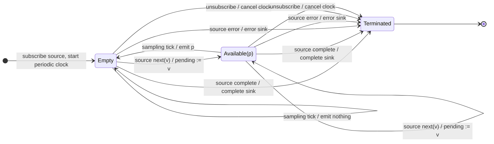

# sampleTime

## Semantic essence

`sampleTime` retains the latest source value received since the previous sampling tick. An independent periodic clock begins with subscription. Source activity never starts, restarts, or delays that clock. Each tick emits the latest unsampled value if available.

## Core BDD

```text
Given no sample is pending
When a source value arrives
Then retain it as the pending sample
And leave the periodic schedule unchanged

Given a sample is pending
When a new source value arrives
Then replace the pending sample
And leave the periodic schedule unchanged

Given a sample is pending
When a sampling tick occurs
Then emit the pending value
And clear its availability

Given no sample is pending
When a sampling tick occurs
Then emit nothing
```

## Mealy machine



## Marble model

```text
source       ^-- a -- x -- y ------- b -- c ------------|
pending          a -> x -> y         b -> c
clock        ^-------------!---------------!---!---------
sink         ^-------------y---------------c-------------|
```

## Business interpretation

Publish the latest telemetry measurement every configured period, but only when a fresh measurement arrived since the previous tick.

## Domain DSL

```ts
function snapshotEvery<T>(ms: number): MonoTypeOperatorFunction<T> {
  return sampleTime(ms);
}
```

## Semantic fingerprint

**latest unsampled value + independent periodic observation clock**
