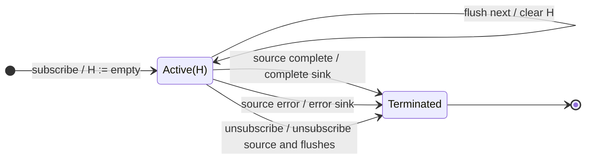

# distinct

## Semantic essence

`distinct` maintains a set of previously admitted keys. A source value is emitted and its key recorded when that key is not already present. A value whose key has already been seen is suppressed. An optional flush event clears the history set.

## Classification

- Policy: global novelty
- Memory topology: history set
- Temporal machinery: none
- Admission: selected key not in seen set
- Reset: optional flush notifier

## Core BDD

```text
Given the selected key has not previously been seen
When a source value arrives
Then emit the source value
And add its key to the seen set

Given the selected key has previously been seen
When a source value arrives
Then suppress the source value
And leave the seen set unchanged

Given remembered keys exist
When the flush notifier emits
Then clear the seen set
And emit nothing
```

## Mealy machine



## Marble model

```text
source       ^-- a -- b -- a -- c -- b -- d ------------|
seen             {a} {a,b}     {a,b,c}     {a,b,c,d}
sink         ^-- a -- b ------- c ------- d -------------|
```

## Business interpretation

Process each business identifier only once within the current memory scope.

## Domain DSL

`admitOnce()` / `admitOnceBy(keySelector)`

## Semantic fingerprint

**global history set + admit unseen + suppress seen + optional reset**
