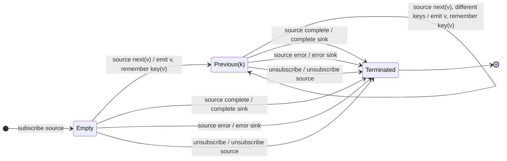

# distinctUntilChanged

## Semantic essence

`distinctUntilChanged` always emits the first source value. It then compares each new value or selected key with that of the most recently admitted value. Equivalent consecutive values are suppressed. A different value is emitted and becomes the new comparison reference.

## Classification

- Policy: local change detection
- Memory topology: one comparison register
- First value: always admitted
- Equal to previous admitted key: suppress
- Different: emit and replace remembered key

## Core BDD

```text
Given no previous value has been admitted
When a source value arrives
Then emit it
And remember its selected key

Given a previous admitted key exists
When a source value arrives with an equivalent key
Then suppress the source value
And retain the existing previous key

Given a previous admitted key exists
When a source value arrives with a different key
Then emit the source value
And replace the remembered key
```

## Mealy machine



## Marble model

```text
source       ^-- a -- a -- b -- b -- a -- a -- c -------|
previous        a        b        a        c
sink         ^-- a ----- b ------- a ------- c ----------|
```

## Business interpretation

Publish application status only when the status differs from the last status published.

## Domain DSL

`whenChanged()` / `whenKeyChanged(keySelector)`

## Semantic fingerprint

**single comparison register + suppress equality + admit local change**
