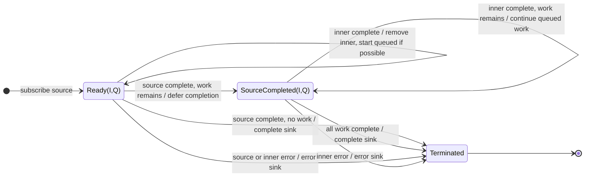

# mergeMap

## Semantic essence

`mergeMap` projects each source value to an inner Observable and subscribes to that inner whenever concurrency capacity is available. Existing inner subscriptions remain active, so multiple inners can overlap and their emissions are merged into the sink as they arrive. With bounded concurrency, excess source work waits for capacity.

## Classification

- Family: higher-order mapping / flattening
- Policy: concurrent merge
- Memory: active inner subscription set, plus waiting work when bounded
- Existing inner: keep
- New work: start when capacity exists
- Cancellation on new source value: none

## Core BDD

```text
Given concurrency capacity is available
When a source value arrives
Then project the source value to an inner Observable
And subscribe to that inner Observable
And keep all previously active inner subscriptions running

Given an inner Observable is active
When that inner emits a value
Then emit the inner value to the sink immediately
And keep the inner active

Given the concurrency limit is reached
When another source value arrives
Then defer that source value until capacity becomes available
```

## Mealy machine



## Marble model

```text
source       ^-- a ----- b --- c ------------------------|
inner a          ^-- a1 ----- a2 --------|
inner b                   ^-- b1 -- b2 --|
inner c                         ^-- c1 ------ c2 --|
sink         ^---- a1 -- b1 -- a2 -- b2 -- c1 -- c2 ----|
```

## Lifecycle

- Source completion waits for admitted inner work to finish.
- Source or inner error terminates the merged computation.
- Downstream unsubscription cancels active inners.
- A new source value does not cancel an existing inner.

## Business interpretation

Run independent work concurrently when every admitted operation matters, such as independent persistence writes.

## Domain DSL

`runConcurrently(project, maxConcurrency?)`

## Semantic fingerprint

**KEEP + START; active-inner set; emissions merged by arrival time**
