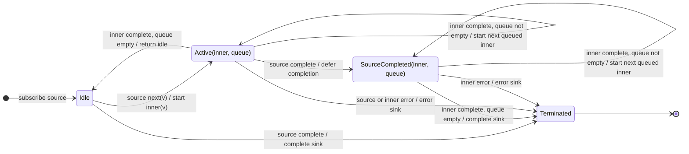

# concatMap

## Semantic essence

`concatMap` projects each source value to an inner Observable, subscribes to one inner at a time, queues later source values while an inner is active, and starts the next queued inner only after the current one completes.

## Classification

- Policy: serialized higher-order mapping
- Memory: one active inner + FIFO queue
- Existing inner: keep
- New work while busy: queue
- Maximum active inners: 1

## Core BDD

```text
Given no inner Observable is active
When a source value arrives
Then project it
And subscribe to the projected inner immediately

Given an inner Observable is active
When a new source value arrives
Then keep the active inner running
And enqueue the new source value
And do not start its inner yet

Given an inner Observable completes
And queued source values exist
When capacity becomes available
Then dequeue the oldest source value
And subscribe to its projected inner
```

## Mealy machine



## Marble model

```text
source       ^-- a -- b -- c ----------------------------|
queue            []  [b] [b,c]
inner a          ^-- a1 -- a2 --|
inner b                         ^-- b1 -- b2 --|
inner c                                        ^-- c1 --|
sink         ^---- a1 -- a2 ------ b1 -- b2 ------ c1 --|
```

## Business interpretation

Run ordered writes or commands one at a time when every operation matters and order must be preserved.

## Domain DSL

`runSequentially(project)`

## Semantic fingerprint

**KEEP + QUEUE; one active slot + FIFO backlog**
