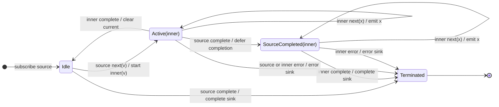

# switchMap

## Semantic essence

`switchMap` maintains at most one active inner Observable. Each new source value is projected to a new inner; if an earlier inner is active, it is cancelled and replaced. Only values from the most recently projected inner reach the sink.

## Classification

- Policy: latest work wins
- Memory: one current inner subscription
- Existing work: cancel
- New work: start immediately
- Queue: none

## Core BDD

```text
Given no inner Observable is active
When a source value arrives
Then project it
And subscribe to its inner Observable

Given an inner Observable is active
When a new source value arrives
Then unsubscribe the active inner
And project the new source value
And subscribe to the replacement inner

Given the current inner emits a value
When that emission occurs
Then emit the value to the sink
```

## Mealy machine



## Marble model

```text
source       ^-- A ----- B ------- C --------------------|
inner A          ^-- a1 -- a2 --x
inner B                       ^-- b1 --x
inner C                                ^-- c1 -- c2 -- c3 --|
sink         ^---- a1 -- a2 ---- b1 ---- c1 -- c2 -- c3 --|
```

## Business interpretation

Latest search, selection, or navigation request wins; obsolete in-flight work is no longer relevant.

## Domain DSL

`latestWins(project)` / `replacePrevious(project)`

## Semantic fingerprint

**CANCEL + START; one replacement subscription slot**
