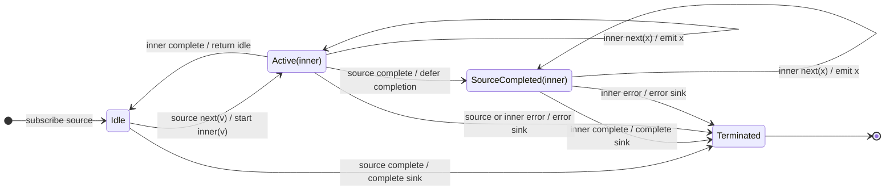

# exhaustMap

## Semantic essence

`exhaustMap` starts projected work only while idle. Once an inner Observable is active, later source values are dropped until that inner completes. The current inner is protected from replacement.

## Classification

- Policy: first admitted work wins while busy
- Memory: one active inner
- Existing work: keep
- New work while busy: drop
- Queue: none

## Core BDD

```text
Given no inner Observable is active
When a source value arrives
Then project it
And subscribe to the projected inner

Given an inner Observable is active
When a new source value arrives
Then keep the active inner running
And drop the new source value
And do not project or queue it

Given the active inner completes
When completion occurs
Then return to idle
```

## Mealy machine



## Marble model

```text
source       ^-- A -- B -- C -------- D -- E ------------|
                 |    x    x          |    x
inner A          ^-- a1 -- a2 -- a3 --|
inner D                                  ^-- d1 -- d2 --|
sink         ^---- a1 -- a2 -- a3 ------- d1 -- d2 -----|
```

## Business interpretation

Protect a form submission, payment, or other non-overlapping operation from repeated triggers while work remains active.

## Domain DSL

`ignoreWhileBusy(project)`

## Semantic fingerprint

**KEEP + DROP; active computation owns admission until completion**
