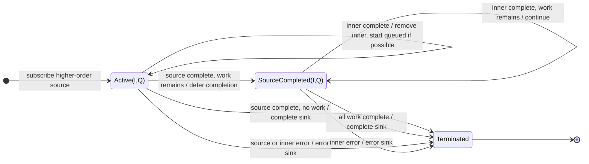

# mergeAll

## Semantic essence

`mergeAll` concurrently flattens a higher-order Observable. The source already emits inner Observables, so there is no projection step. Incoming inners are subscribed when capacity is available, existing inners remain active, and all inner emissions are merged into the sink.

## Classification

- Input: `Observable<Observable<T>>`
- Policy: concurrent merge flattening
- Memory: active inner set + optional waiting inners
- Projection: none

## Core BDD

```text
Given concurrency capacity is available
When the higher-order source emits an inner Observable
Then subscribe to that inner Observable
And keep existing inner Observables active

Given an active inner emits a value
When the value arrives
Then emit it to the sink immediately

Given concurrency capacity is full
When another inner arrives
Then defer that inner until capacity becomes available
```

## Mealy machine



## Marble model

```text
source       ^-- A$ ----- B$ --- C$ ---------------------|
inner A          ^-- a1 ----- a2 --------|
inner B                   ^-- b1 -- b2 --|
inner C                         ^-- c1 ------ c2 --|
sink         ^---- a1 -- b1 -- a2 -- b2 -- c1 -- c2 ----|
```

## Structural relation

```text
mergeMap(project) = map(project) + mergeAll()
```

## Domain DSL

`runAllConcurrently()`

## Semantic fingerprint

**flatten only; KEEP + START**
