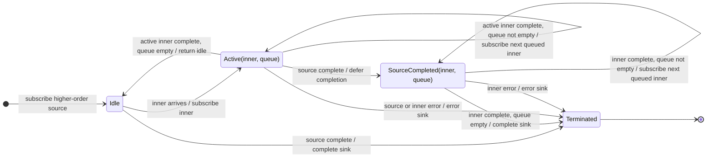

# concatAll

## Semantic essence

`concatAll` serially flattens a higher-order Observable. It subscribes to one inner at a time, queues later inner Observables in arrival order, and advances to the next only when the current inner completes.

## Classification

- Input: `Observable<Observable<T>>`
- Policy: serialized flattening
- Memory: one active inner + FIFO inner queue
- Projection: none

## Core BDD

```text
Given no inner Observable is active
When an inner Observable arrives
Then subscribe immediately

Given an inner Observable is active
When another inner arrives
Then keep the active inner running
And enqueue the new inner

Given the active inner completes
And the queue is not empty
When completion occurs
Then dequeue and subscribe to the oldest waiting inner
```

## Mealy machine



## Marble model

```text
source       ^-- A$ -- B$ -- C$ -------------------------|
queue            []  [B] [B,C]
inner A          ^-- a1 -- a2 -- a3 --|
inner B                               ^-- b1 -- b2 --|
inner C                                             ^-- c1 --|
sink         ^---- a1 -- a2 -- a3 ------ b1 -- b2 ------ c1 --|
```

## Structural relation

```text
concatMap(project) = map(project) + concatAll()
concatAll() conceptually occupies mergeAll(concurrency = 1)
```

## Domain DSL

`runSequentially()`

## Semantic fingerprint

**flatten only; KEEP + QUEUE**
