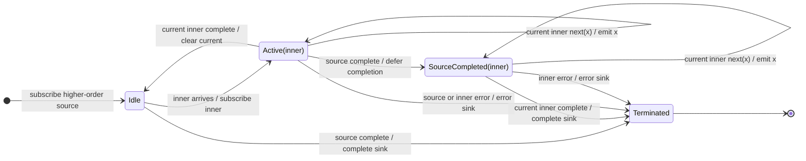

# switchAll

## Semantic essence

`switchAll` flattens a higher-order Observable by maintaining only the most recently emitted inner Observable. A new inner cancels the current inner and becomes the new current subscription. Only current-inner values reach the sink.

## Classification

- Input: `Observable<Observable<T>>`
- Policy: replacement flattening
- Memory: one current inner
- Projection: none
- Queue: none

## Core BDD

```text
Given no inner Observable is active
When an inner Observable arrives
Then subscribe to it
And make it current

Given an inner Observable is active
When a new inner Observable arrives
Then unsubscribe the current inner
And subscribe to the new inner
And make the new inner current

Given the current inner emits
When the value arrives
Then emit the value to the sink
```

## Mealy machine



## Marble model

```text
source       ^-- A$ ----- B$ ----- C$ -------------------|
inner A          ^-- a1 -- a2 --x
inner B                       ^-- b1 ----x
inner C                                  ^-- c1 -- c2 -- c3 --|
sink         ^---- a1 -- a2 ---- b1 ------ c1 -- c2 -- c3 --|
```

## Structural relation

```text
switchMap(project) = map(project) + switchAll()
```

## Domain DSL

`observeLatest()` / `useCurrentStream()`

## Semantic fingerprint

**flatten only; CANCEL + START**
