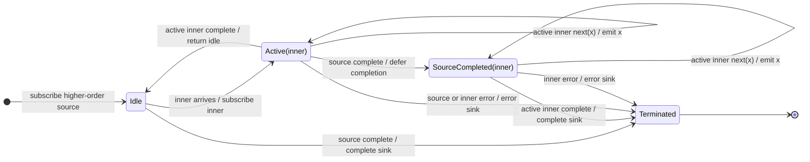

# exhaustAll

## Semantic essence

`exhaustAll` subscribes to an incoming inner Observable only while idle. While an admitted inner remains active, newly arriving inner Observables are dropped. The current inner is protected until completion.

## Classification

- Input: `Observable<Observable<T>>`
- Policy: first-inner-wins-while-busy flattening
- Memory: one active inner
- Queue: none
- Projection: none

## Core BDD

```text
Given no inner Observable is active
When an inner Observable arrives
Then subscribe to it
And make it active

Given an inner Observable is active
When another inner Observable arrives
Then keep the active inner running
And drop the newly arrived inner
And do not subscribe or queue it

Given the active inner completes
When completion occurs
Then return to idle
```

## Mealy machine



## Marble model

```text
source       ^-- A$ -- B$ -- C$ -------- D$ -- E$ -------|
                 |     x     x           |     x
inner A          ^-- a1 -- a2 -- a3 --|
inner D                                  ^-- d1 -- d2 --|
sink         ^---- a1 -- a2 -- a3 -------- d1 -- d2 -----|
```

## Structural relation

```text
exhaustMap(project) = map(project) + exhaustAll()
```

## Domain DSL

`protectCurrentWork()`

## Semantic fingerprint

**flatten only; KEEP + DROP**
