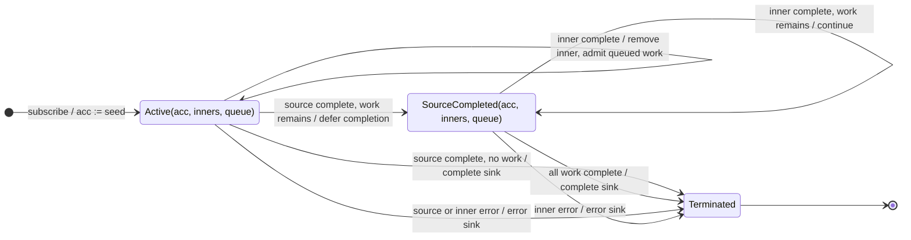

# mergeScan

## Semantic essence

`mergeScan` maintains accumulator state while using an Observable-producing accumulator function. For each admitted source value, the accumulator function receives the current accumulator and returns inner work. Inner emissions become both the new accumulator state and sink emissions. The inner work follows merge-style concurrency.

## Classification

- Family: higher-order accumulation
- Policy: merge concurrency + state feedback
- State: current accumulator + active inners + optional waiting work
- Initial state: seed
- Feedback target: accumulator state

## Core BDD

```text
Given mergeScan holds the current accumulator
And concurrency capacity is available
When a source value arrives
Then invoke the accumulator function with the accumulator and source value
And subscribe to the returned inner Observable

Given an accumulator inner Observable is active
When that inner emits a value
Then replace the current accumulator with the emitted value
And emit the same value to the sink

Given concurrency capacity is exhausted
When another source value arrives
Then defer that source work until capacity becomes available
```

## Mealy machine



## Feedback model

```text
                 +-------------------+
                 |                   |
                 |                   v
source ------> accumulator(acc,value) --> inner
                 ^                   |
                 |                   | emits acc'
                 |                   v
                 +------ acc := acc'-+
                                     |
                                     v
                                    sink
```

## Comparison with scan

```text
scan:
    (state, input) -> state'

mergeScan:
    (state, input) -> Observable<state'>
```

## Business interpretation

Asynchronous cumulative state evolution, such as incrementally acquiring and publishing accumulated data.

## Domain DSL

`evolveAsync(seed, transition)` / `accumulateAsync(seed, accumulator)`

## Semantic fingerprint

**merge-style higher-order work + inner result fed back into accumulator state**
