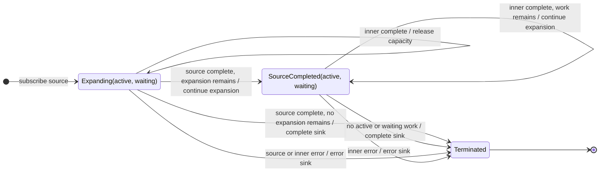

# expand

## Semantic essence

`expand` recursively projects admitted values into further Observable work. Values produced by expansion are emitted to the sink and are also fed back as new inputs to the same projection process, unfolding a potentially recursive stream of values.

## Classification

- Family: recursive higher-order transformation
- Policy: recursive work generation
- Feedback target: projection input
- Operational state: active recursive work + waiting frontier when bounded
- Termination: expansion frontier eventually empties or downstream terminates

## Core BDD

```text
Given a value has been admitted into the expansion
When the value is processed
Then emit the value to the sink
And project the value to an inner Observable
And admit values from that inner Observable back into the expansion

Given an expansion inner Observable emits a value
When that value arrives
Then emit the value to the sink
And use the value as another projection input
```

## Mealy machine



## Recursive model

```text
A
|\
| +--> C --> E
+----> B --> D

Each admitted value:
1. is emitted
2. is projected
3. may generate successor values
4. those successors re-enter the same process
```

## Linear marble model

```text
source       ^-- A --|
generation 0     A
                 +-- project(A)
generation 1         ^-- B --|
                         +-- project(B)
generation 2             ^-- C --|
                             +-- project(C)
generation 3                 ^-- D --|
sink         ^-- A -- B -- C -- D -----------------------|
```

## Comparison with mergeScan

```text
mergeScan:
    inner result -> accumulator state

expand:
    inner result -> new projection input
```

## Business interpretation

Recursive traversal or pagination in which each response supplies the information needed to obtain successor work.

## Domain DSL

`unfoldAsync(project)` / `followNext(project)`

## Semantic fingerprint

**emit + recursively project + feed generated values back into work generation**
