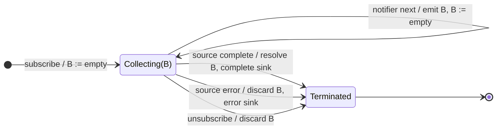

# buffer

## Semantic essence

`buffer` maintains one current collection. Every source value is appended to that collection. Whenever the closing notifier emits, the current collection is emitted as an array, cleared, and collection continues in a new empty buffer.

## Classification

- Family: buffering / batching
- State: one current `Array<T>`
- Opening: continuous
- Closing: external notifier
- Membership: each source value belongs to the current buffer
- Representation: `T[]`

## Core BDD

```text
Given a buffer is open
When a source value arrives
Then append the source value to the current buffer
And emit nothing to the sink

Given a current buffer exists
When the closing notifier emits
Then emit the current buffer to the sink
And replace it with a new empty buffer
```

## Mealy machine



## Marble model

```text
source       ^-- a -- b -- c -------- d -- e ------ f --|
buffer           [a] [a,b] [a,b,c]    [d] [d,e]    [f]
notifier     ^--------------!---------------!-------------
sink         ^----------[a,b,c]-----------[d,e]-----------|
```

## Business interpretation

Batch analytics or domain events until an external flush signal occurs.

## Domain DSL

`batchUntil(flush$)` / `collectUntil(boundary$)`

## Semantic fingerprint

**collect all + external boundary + emit array + reset**
