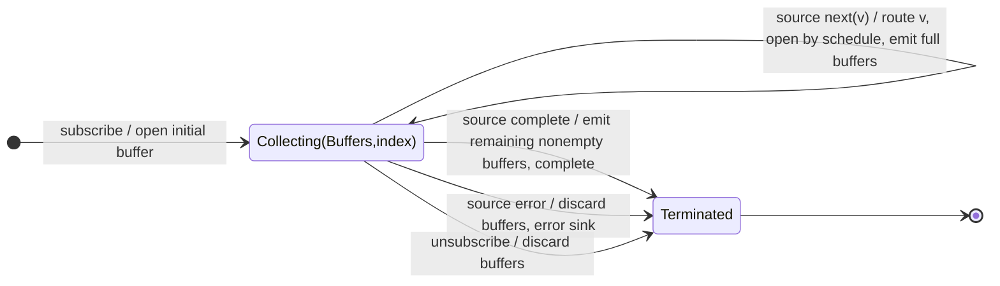

# bufferCount

## Semantic essence

`bufferCount` forms array-valued source segments using count-based opening and closing rules. A buffer emits when it reaches `bufferSize`; `startBufferEvery` determines how frequently new buffers begin and therefore whether segments are adjacent, overlapping, or separated.

## Classification

- Closing: count reaches `bufferSize`
- Opening: count position / `startBufferEvery`
- State: one or more active arrays
- Representation: `T[]`

## Core BDD

```text
Given one or more buffers are open
When a source value arrives
Then append it to every active buffer
And open a new buffer when the configured start interval is reached
And emit and remove each buffer that reaches bufferSize
```

## Mealy machine



## Basic marble

```text
source       ^-- a -- b -- c -- d -- e -- f -- g --|
buffer 1        [a] [a,b] [a,b,c]
buffer 2                    [d] [d,e] [d,e,f]
sink         ^--------[a,b,c]--------[d,e,f]--[g]--|
```

## Segment geometry

```text
startEvery < size  -> overlap
startEvery = size  -> adjacent
startEvery > size  -> gaps
```

## Business interpretation

Fixed-size bulk processing or sliding-count analysis.

## Domain DSL

`batchEvery(count)` / `slidingWindow(size, step)`

## Semantic fingerprint

**count-defined opening + count-defined closing + array materialization**
