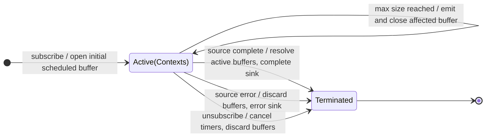

# bufferTime

## Semantic essence

`bufferTime` opens buffers according to a time schedule, appends each source value to every active buffer, and emits a buffer when its configured time span expires or, when configured, its maximum size is reached.

## Classification

- Opening: temporal schedule
- Closing: elapsed time, optionally max size
- State: one or more active arrays and timers
- Representation: `T[]`
- Overlap/gaps: configurable

## Core BDD

```text
Given one or more time buffers are open
When a source value arrives
Then append it to every active buffer

Given a time buffer is active
When its configured time span expires
Then emit and close that buffer
And open replacements according to the creation schedule

Given maxBufferSize is configured
When a buffer reaches that size first
Then emit and close that buffer immediately
```

## Mealy machine



## Marble model

```text
source       ^-- a -- b -- c ------ d -- e -------- f --|
timer        ^--------------!---------------!------------
sink         ^----------[a,b,c]----------[d,e]------------|
```

## Geometry

```text
creationInterval < span -> overlap
creationInterval = span -> adjacent
creationInterval > span -> gaps
```

## Business interpretation

Time-based telemetry, analytics, or log batching, optionally released early when a maximum batch size is reached.

## Domain DSL

`batchEvery(ms)` / `batchByTime({ spanMs, maxItems })`

## Semantic fingerprint

**temporal segment geometry + array materialization + competing time/size boundaries**
