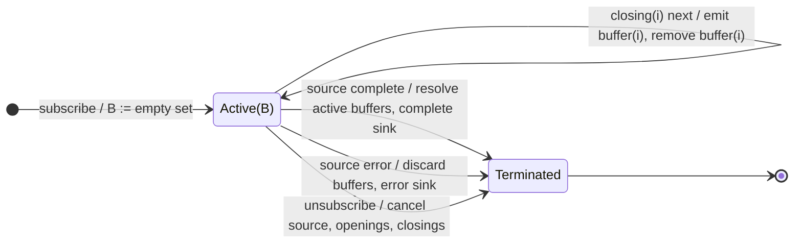

# bufferToggle

## Semantic essence

`bufferToggle` opens a new buffer whenever `openings` emits. Each opening obtains its own closing Observable from `closingSelector`. Every source value is appended to every active buffer. A buffer is emitted and removed when its corresponding closing Observable emits.

## Classification

- Opening: arbitrary opening Observable
- Closing: per-opening selector
- State: dynamic set of active buffer contexts
- Membership: fan out source values to all active buffers
- Representation: `T[]`
- Overlap/gaps: allowed

## Core BDD

```text
Given bufferToggle is active
When openings emits o
Then create a new empty buffer
And subscribe to closingSelector(o)
And add the buffer to the active set

Given one or more buffers are active
When a source value arrives
Then append it to every active buffer

Given buffer i is active
When its closing Observable emits
Then emit buffer i
And remove buffer i from the active set
```

## Mealy machine



## Marble model

```text
source        ^-- a -- b -- c -- d -- e -- f -- g ------|
openings      ^----!---------!---------------------------
buffer B1         [a] [a,b] [a,b,c] [a,b,c,d] -> emit
buffer B2                   [c] [c,d] [c,d,e] [c,d,e,f] -> emit
sink          ^----------------[a,b,c,d]----[c,d,e,f]----|
```

## Business interpretation

Collect events inside explicitly delimited, potentially overlapping scopes such as complete pointer gestures.

## Domain DSL

`collectBetween(openings$, closingSelector)`

## Semantic fingerprint

**dynamic active-buffer set + independent open/close lifecycle + fan-out membership**
