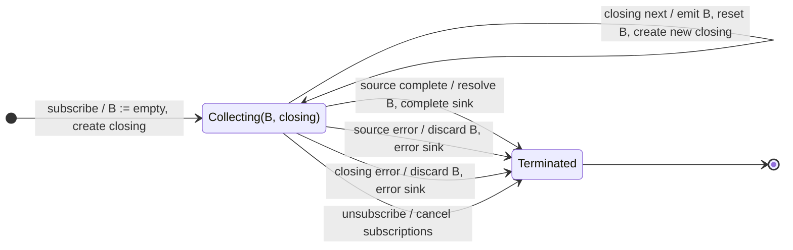

# bufferWhen

## Semantic essence

`bufferWhen` continuously maintains one buffer. It opens immediately, obtains a closing Observable from `closingSelector()`, emits the current array when that closing Observable signals, and immediately opens the next buffer with a newly generated closing Observable.

## Classification

- Opening: immediate and continuous
- Closing: dynamically regenerated selector
- State: one current buffer + one closing subscription
- Representation: `T[]`
- Geometry: sequential partition, no normal overlap/gaps

## Core BDD

```text
Given a current buffer is open
When a source value arrives
Then append it to the current buffer

Given a current closing Observable is active
When it emits
Then emit the current buffer
And open a new empty buffer immediately
And invoke closingSelector again
And subscribe to the new closing Observable
```

## Mealy machine



## Marble model

```text
source       ^-- a -- b -- c ---- d -- e ------ f -- g --|
closing 1    ^--------------!
closing 2                   ^----------!
closing 3                               ^----------!
sink         ^----------[a,b,c]------[d,e]-------[f,g]----|
```

## Business interpretation

Adaptive continuous batching where every completed batch may choose a different next boundary policy.

## Domain DSL

`collectByDynamicBoundary(closingSelector)`

## Semantic fingerprint

**one continuous buffer + regenerated boundary per segment + array representation**
