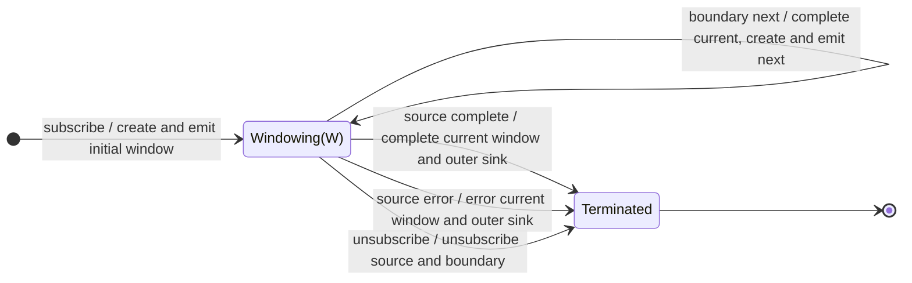

# window

## Semantic essence

`window` divides the source into sequential live Observable segments. Source values flow through the current window as they arrive. A boundary signal completes that window, creates a replacement window, and exposes the new window through the outer sink.

## Classification

- Opening: initial window plus replacement after boundary
- Closing: boundary Observable
- State: one current live window
- Representation: `Observable<T>`
- Outer result: `Observable<Observable<T>>`

## Core BDD

```text
Given a current window is open
When a source value arrives
Then emit the source value through the current window

Given a current window is open
When the boundary Observable emits
Then complete the current window
And create a new window
And emit the new window to the outer sink
```

## Mealy machine



## Marble model

```text
source        ^-- a -- b -- c ---- d -- e ---- f --|
boundary      ^--------------!----------!-----------
window 1      ^-- a -- b -- c |
window 2                    ^-- d -- e --|
window 3                                ^-- f --|
outer sink    ^-- W1 -------- W2 -------- W3 --------|
```

## Business interpretation

Expose each event session as a live stream so per-session processing can begin before the session ends.

## Domain DSL

`segmentBy(boundary$)`

## Semantic fingerprint

**sequential notifier segmentation + live-stream representation**
