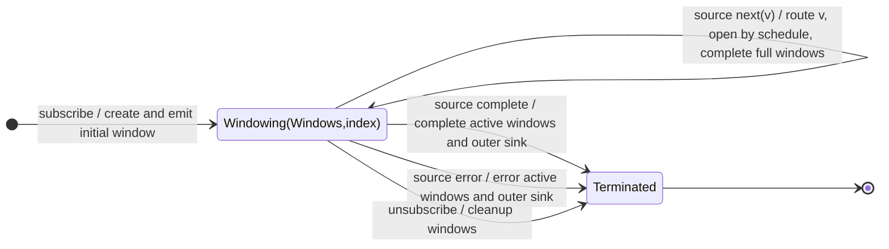

# windowCount

## Semantic essence

`windowCount` exposes count-defined source segments as live Observables. Values flow into active windows; a window completes when its configured size is reached. The opening step controls whether windows are adjacent, overlapping, or separated.

## Classification

- Opening: count schedule
- Closing: count size
- State: one or more active live windows
- Representation: `Observable<T>`
- Geometry: adjacent / overlap / gaps

## Core BDD

```text
Given one or more windows are active
When a source value arrives
Then emit the value through every active window
And open new windows according to the count start schedule
And complete windows that reach their configured size
```

## Mealy machine



## Basic marble

```text
source        ^-- a -- b -- c -- d -- e -- f -- g --|
window 1      ^-- a -- b -- c --|
window 2                     ^-- d -- e -- f --|
window 3                                    ^-- g --...
outer sink    ^-- W1 ---------- W2 ---------- W3 -----|
```

## Business interpretation

Expose fixed-size event groups as independently composable streams rather than waiting for complete arrays.

## Domain DSL

`segmentEvery(count)` / `streamGroupsOf(count)`

## Semantic fingerprint

**count geometry + live-stream representation**
