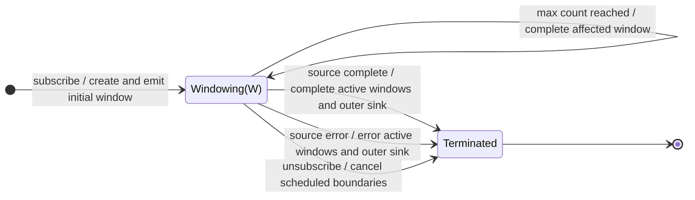

# windowTime

## Semantic essence

`windowTime` exposes time-defined source segments as live inner Observables. Windows open according to a temporal schedule, source values are routed into every active window, and a window completes when its time span or configured maximum count is reached.

## Classification

- Opening: temporal schedule
- Closing: time span, optionally max count
- State: one or more active windows and timers
- Representation: `Observable<T>`
- Overlap/gaps: configurable

## Core BDD

```text
Given one or more time windows are active
When a source value arrives
Then emit it through every active window

Given a time window is active
When its time span expires
Then complete that window
And open replacements according to the temporal schedule

Given maxWindowCount is configured
When a window reaches that count first
Then complete that window immediately
```

## Mealy machine



## Marble model

```text
source        ^-- a -- b -- c ---- d -- e ------ f --|
time          ^--------------!--------------!---------
window 1      ^-- a -- b -- c |
window 2                    ^-- d -- e ------|
window 3                                   ^-- f --...
outer sink    ^-- W1 -------- W2 ----------- W3 -------|
```

## Business interpretation

Create live analytical streams for successive or overlapping time frames, such as per-minute telemetry processing.

## Domain DSL

`timeWindows(spanMs, startEveryMs?)`

## Semantic fingerprint

**temporal geometry + live-stream representation + competing time/count close conditions**
