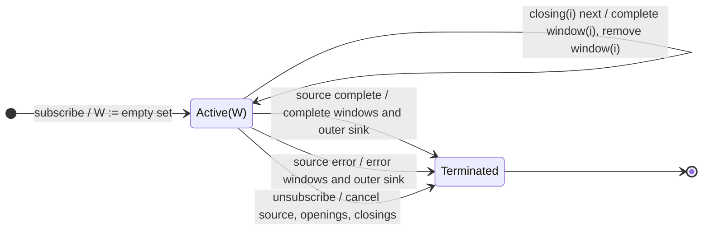

# windowToggle

## Semantic essence

`windowToggle` dynamically creates live windows from opening events. Each window receives its own closing Observable from `closingSelector`. Every source value is emitted through every currently active window. Each window completes independently when its closing signal occurs.

## Classification

- Opening: arbitrary openings Observable
- Closing: per-opening selector
- State: dynamic set of active live windows
- Membership: fan out source values to all active windows
- Representation: `Observable<T>`
- Overlap/gaps: allowed

## Core BDD

```text
Given windowToggle is active
When openings emits o
Then create a new window
And emit the window to the outer sink
And subscribe to closingSelector(o)

Given one or more windows are active
When a source value arrives
Then emit that value through every active window

Given window i is active
When its closing Observable emits
Then complete window i
And remove it from the active set
```

## Mealy machine



## Marble model

```text
source        ^-- a -- b -- c -- d -- e -- f -- g ------|
openings      ^----!---------!---------------------------
window W1         ^-- a -- b -- c -- d --|
window W2                   ^-- c -- d -- e -- f --|
outer sink    ^----W1--------W2--------------------------|
```

## Business interpretation

Expose explicitly delimited, potentially overlapping business or interaction scopes as live streams.

## Domain DSL

`streamBetween(openings$, closingSelector)`

## Semantic fingerprint

**dynamic active-window set + independent open/close lifecycle + streaming fan-out**
