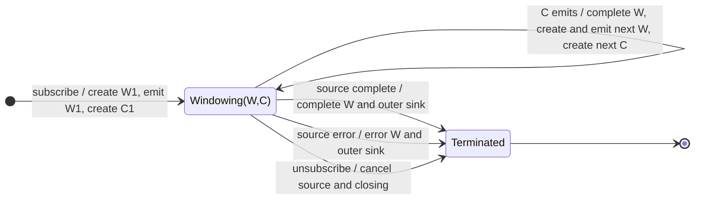

# windowWhen

## Semantic essence

`windowWhen` continuously maintains one live window. It creates and emits an initial window, obtains its closing Observable from `closingSelector()`, and when that closing Observable emits it completes the current window, immediately creates and emits the next window, and regenerates the next closing boundary.

## Classification

- Opening: immediate and continuous
- Closing: dynamically regenerated selector
- State: one current live window + one closing subscription
- Representation: `Observable<T>`
- Geometry: continuous sequential partition

## Core BDD

```text
Given a current window is open
When a source value arrives
Then emit that value through the current window

Given the current closing Observable is active
When it emits
Then complete the current window
And create and emit the next window immediately
And invoke closingSelector again
And subscribe to the new closing Observable
```

## Mealy machine



## Marble model

```text
source        ^-- a -- b -- c ---- d -- e ------ f -- g --|
close 1       ^--------------!
window 1      ^-- a -- b -- c |
close 2                      ^----------!
window 2                     ^-- d -- e --|
close 3                                  ^----------!
window 3                                 ^-- f -- g --|
outer sink    ^-- W1 -------- W2 -------- W3 -------------|
```

## Business interpretation

Continuously partition a live stream into dynamically sized stream segments, re-evaluating the next boundary after every segment.

## Domain DSL

`streamByDynamicBoundary(closingSelector)`

## Semantic fingerprint

**one continuous live window + regenerated boundary per segment + streaming representation**
