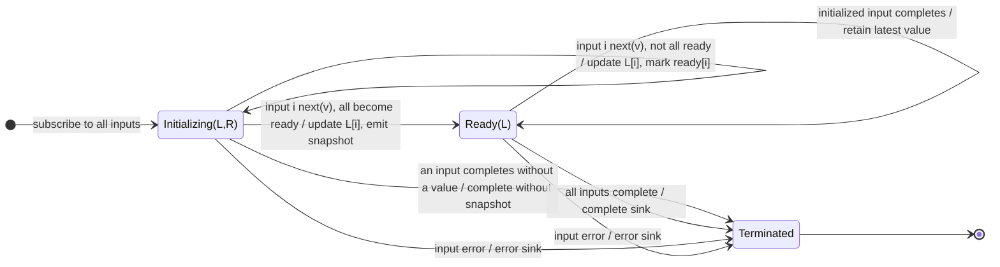

# combineLatest

## Semantic essence

`combineLatest` maintains one latest-value register for each input Observable. Before all registers have been initialized, incoming values update their corresponding registers without output. Once every input has emitted at least once, every subsequent input emission updates its register and emits a complete snapshot containing the latest value from every input.

## Classification

- Family: multi-stream combination
- Policy: latest-state synchronization
- Memory: latest-value register bank + readiness mask
- Readiness: every input has emitted
- Trigger after readiness: any input
- Output: complete latest-value tuple

## Core BDD

```text
Given not every input has emitted at least one value
When input i emits value v
Then store v as input i's latest value
And mark input i as ready
And emit nothing unless every input is now ready

Given every input is ready
When input i emits value v
Then replace input i's latest value
And emit the complete latest-value snapshot
```

## Mealy machine



## Marble model

```text
A             ^-- a1 -------- a2 ----------------|
B             ^------ b1 ----------- b2 ---------|
C             ^---------- c1 ------------ c2 ----|
sink          ^----------[a1,b1,c1]
                         --[a2,b1,c1]
                                  --[a2,b2,c1]
                                           --[a2,b2,c2]
```

## Business interpretation

Maintain a synchronized current snapshot of several evolving state streams, such as reactive form fields or device state.

## Domain DSL

`latestStateOf(...)` / `synchronizeLatest(...)`

## Semantic fingerprint

**register bank + global readiness + any-input trigger + latest snapshot**
