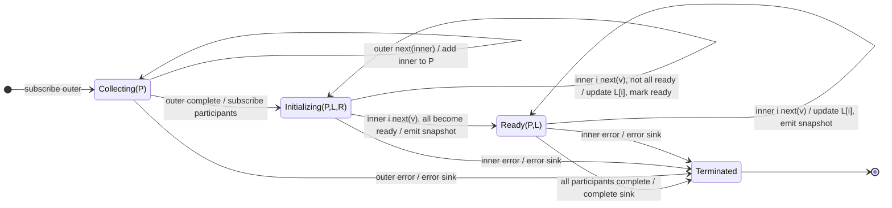

# combineLatestAll

## Semantic essence

`combineLatestAll` first collects inner Observables from a higher-order source. When the outer Observable completes, the participant set is finalized and latest-value coordination begins: one register is maintained per inner, all inners must initialize, and any subsequent inner update emits a complete latest snapshot.

## Classification

- Family: higher-order coordination
- Participant definition: discovered from outer source
- Participant barrier: outer completion
- Memory after discovery: latest register bank + readiness mask
- Trigger: any participant after readiness

## Core BDD

```text
Given the outer Observable has not completed
When it emits an inner Observable
Then add the inner Observable to the participant collection
And emit nothing

Given participant Observables have been collected
When the outer Observable completes
Then finalize the participant set
And subscribe to the collected inners
And initialize latest-value registers and readiness state

Given all participant registers are initialized
When participant i emits value v
Then update its register
And emit the complete latest snapshot
```

## Mealy machine



## Structural model

```text
DISCOVER INPUTS
A$ B$ C$
    |
outer completes
    |
    v
LATEST-STATE COORDINATION
```

## Business interpretation

Discover a finite set of live state streams during setup, then continuously expose their synchronized latest state.

## Domain DSL

`latestStateOfAll()` / `combineDiscoveredLatest()`

## Semantic fingerprint

**discovered participant set + register bank + initialization barrier + any-inner trigger**
