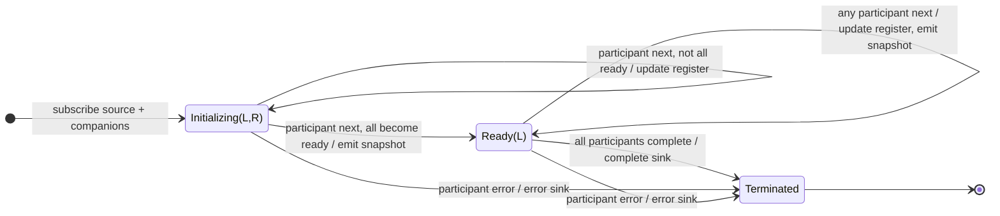

# combineLatestWith

## Semantic essence

`combineLatestWith` expresses latest-state synchronization in pipeable form. It maintains one latest-value register for the pipeline source and each supplied companion, waits until all participants have emitted, and thereafter emits a complete latest-value tuple whenever any participant changes.

## Classification

- Participant form: pipeline source + companions
- Memory: latest register per participant + readiness mask
- Readiness: all participants initialized
- Trigger: any participant
- Syntax: asymmetric
- Trigger semantics: symmetric

## Core BDD

```text
Given not every participant has emitted
When participant i emits value v
Then update participant i's latest register
And mark participant i ready
And emit only if all participants are now ready

Given every participant is ready
When any participant emits value v
Then update that participant's register
And emit the complete latest tuple
```

## Mealy machine



## Business interpretation

Continuously derive state from a pipeline source and multiple companion state streams whenever any input changes.

## Domain DSL

`synchronizeWithLatest(...)`

## Semantic fingerprint

**pipeline participant form + register bank + all-ready + symmetric triggering**
