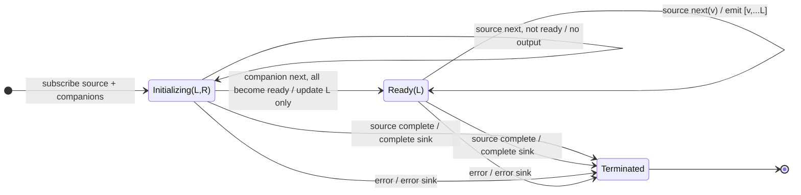

# withLatestFrom

## Semantic essence

`withLatestFrom` retains the latest values of companion Observables as contextual state. Companion emissions update memory without producing output. The pipeline source alone triggers output, and only after every companion has supplied an initial value.

## Classification

- Policy: triggered latest-state snapshot
- Roles: one trigger source + N companion state sources
- Memory: latest register per companion
- Readiness: every companion initialized
- Trigger ownership: source only

## Core BDD

```text
Given withLatestFrom is subscribed
When companion i emits value v
Then store v in companion i's latest register
And mark companion i ready
And emit nothing

Given at least one companion is not ready
When the source emits
Then emit no combined value

Given every companion is ready
When the source emits value s
Then emit [s, ...latestCompanionValues]
```

## Mealy machine



## Business interpretation

Enrich a command/event with current state, such as Submit + current form state + current user.

## Domain DSL

`snapshotWithLatest(...)` / `enrichWithLatest(...)`

## Semantic fingerprint

**companion register bank + readiness + source-only trigger**
