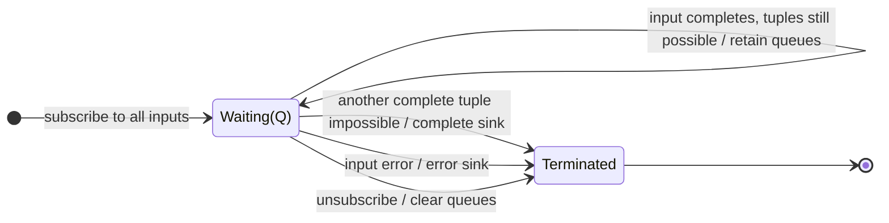

# zip

## Semantic essence

`zip` coordinates several inputs positionally. Each input has a FIFO queue of unmatched values. Whenever every queue is nonempty, `zip` removes the oldest value from each queue and emits them together, pairing first with first, second with second, and so on.

## Classification

- Policy: positional rendezvous
- Memory: FIFO queue per input
- Readiness: every queue nonempty
- Consumption: one value per queue
- Value reuse: none
- Output: positional tuple

## Core BDD

```text
Given input i has a FIFO queue
When input i emits value v
Then enqueue v
And emit nothing unless every input queue is nonempty

Given every input queue is nonempty
When the next rendezvous is possible
Then dequeue the oldest value from every queue
And emit those values together in input order
```

## Mealy machine



## Marble model

```text
A          ^-- a1 -- a2 -- a3 ------------------|
B          ^------ b1 -------- b2 ---- b3 -------|
C          ^---------- c1 -------- c2 ---- c3 ---|
sink       ^----------[a1,b1,c1]
                     -------[a2,b2,c2]
                                ----[a3,b3,c3]
```

## Business interpretation

Align ordered values from related streams one-to-one, such as corresponding identifiers and results.

## Domain DSL

`rendezvous(...)` / `alignByPosition(...)`

## Semantic fingerprint

**FIFO queue bank + repeated all-nonempty rendezvous + consumptive positional tuple**
