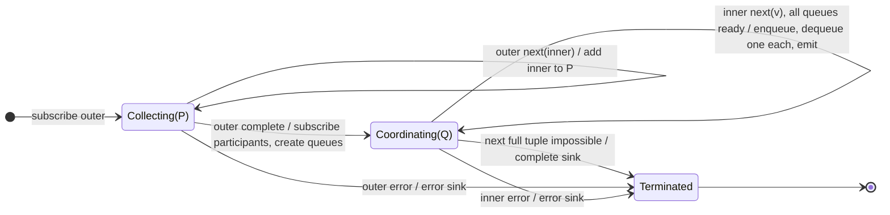

# zipAll

## Semantic essence

`zipAll` collects participant Observables from a higher-order source. When the outer source completes, it subscribes to the finalized participant set and performs positional rendezvous using one FIFO queue per participant.

## Classification

- Participant definition: discovered from higher-order source
- Participant barrier: outer completion
- Coordination: positional rendezvous
- Memory after discovery: FIFO queue per participant

## Core BDD

```text
Given the outer Observable has not completed
When it emits an inner Observable
Then add that inner to the participant collection

Given participants have been collected
When the outer completes
Then subscribe to every collected participant
And create one FIFO queue per participant

Given every queue is nonempty
When the next positional tuple is available
Then dequeue one value from every queue
And emit the tuple
```

## Mealy machine



## Business interpretation

Discover a finite set of ordered worker streams, then combine their corresponding results by position.

## Domain DSL

`rendezvousAll()`

## Semantic fingerprint

**discovered participant set + FIFO queue bank + positional consumption**
