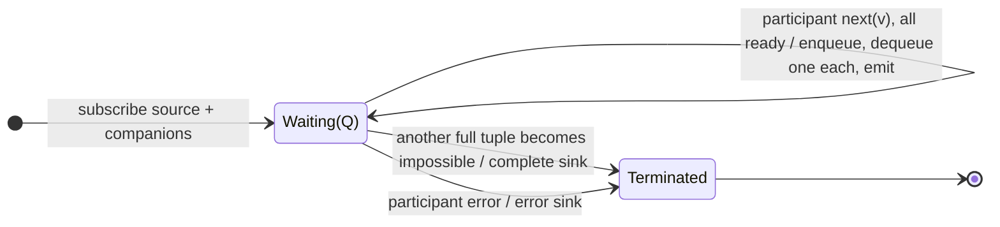

# zipWith

## Semantic essence

`zipWith` is the pipeable positional-rendezvous form. The pipeline source and each supplied companion have FIFO queues. Whenever every participant has an unmatched value, one value is removed from every queue and emitted as the next corresponding tuple.

## Classification

- Participant form: pipeline source + companions
- Coordination: positional rendezvous
- Memory: FIFO queue per participant
- Trigger: event completing the next rendezvous

## Core BDD

```text
Given each participant has a FIFO queue
When participant i emits value v
Then enqueue v
And emit nothing unless all queues are nonempty

Given all participant queues are nonempty
When the next positional tuple is available
Then dequeue one value from every queue
And emit the combined tuple
```

## Mealy machine



## Business interpretation

Align a pipeline stream with companion streams by corresponding emission position.

## Domain DSL

`rendezvousWith(...)` / `alignWith(...)`

## Semantic fingerprint

**pipeline participant form + FIFO queue bank + consumptive indexed alignment**
