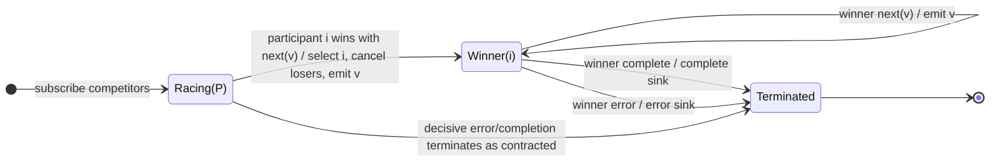

# race

## Semantic essence

`race` performs one-shot competitive source selection. The competing Observables are subscribed and the first participant to win according to the race contract becomes authoritative. Losing participants stop participating, and the result follows the winner.

## Classification

- Policy: competitive selection
- Initial state: unresolved candidate set
- Memory after selection: winner identity
- Loser policy: unsubscribe / cease participation
- Reselection: none

## Core BDD

```text
Given the competition is unresolved
When participant i produces the winning emission/event
Then select participant i
And propagate the winning notification
And stop participation by losing sources

Given participant i has won
When the winner emits subsequently
Then mirror the winner to the sink
```

## Mealy machine



## Marble model

```text
A          ^------------ a1 -- a2
                    x
B          ^---- b1 ---- b2 ---- b3 --|
                |
                +-- winner
C          ^-------- c1 -- c2
                    x
sink       ^---- b1 ---- b2 ---- b3 --|
```

## Business interpretation

Choose one competing source on a first-response basis and stop waiting for alternatives.

## Domain DSL

`firstToEmit(...)` / `compete(...)`

## Semantic fingerprint

**candidate set -> one-shot winner -> cancel losers -> mirror winner**
