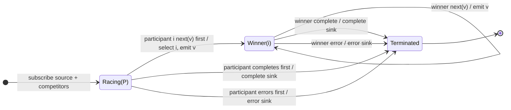

# raceWith

## Semantic essence

`raceWith` expresses one-shot competitive selection in pipeable form. The pipeline source and supplied competitors race; the participant producing the first decisive notification becomes authoritative, and the result follows that participant rather than combining values across streams.

## Classification

- Participant form: pipeline source + competitors
- State: racing candidate set, then winner identity
- Selection: first decisive notification under the operator contract
- Loser policy: cease participation
- Reselection: none

## Core BDD

```text
Given no winner has been selected
When participant i produces the first decisive notification
Then participant i determines the result
And competing participants stop participating
And propagate the winning notification according to its type

Given a value-producing winner is selected
When the winner emits again
Then emit that value to the sink
```

## Mealy machine



## Business interpretation

Race a primary process against alternative or timeout streams and commit to the first decisive participant.

## Domain DSL

`raceAgainst(...)` / `firstSignalWins(...)`

## Semantic fingerprint

**pipeline competition + one-shot selection + winner mirroring**
