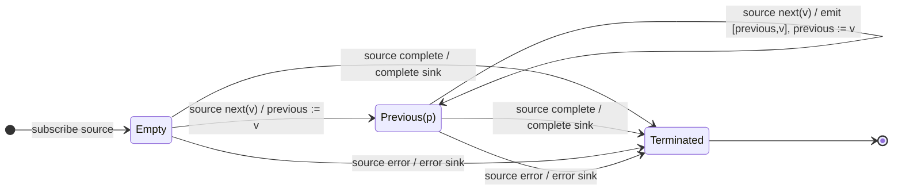

# pairwise

## Semantic essence

`pairwise` retains the immediately previous source value. The first value initializes that memory without output. Every subsequent source value is emitted together with the previous value as `[previous, current]`, then becomes the new previous value.

## Classification

- Family: local temporal coordination
- Participants: consecutive positions in one source
- Memory: one previous-value register
- Readiness: previous value exists
- Geometry: sliding pair, step 1

## Core BDD

```text
Given no previous value exists
When the first source value arrives
Then remember it as previous
And emit nothing

Given a previous value exists
When a new source value arrives
Then emit [previous,current]
And replace previous with current
```

## Mealy machine



## Marble model

```text
source       ^-- a ----- b ----- c ----- d ----- e --|
sink         ^------[a,b]---[b,c]---[c,d]---[d,e]---|
```

## Business interpretation

Expose state transitions, deltas, direction, velocity, or change between consecutive values.

## Domain DSL

`transitions()`

## Semantic fingerprint

**previous register + current trigger + overlapping [previous,current] transition**
