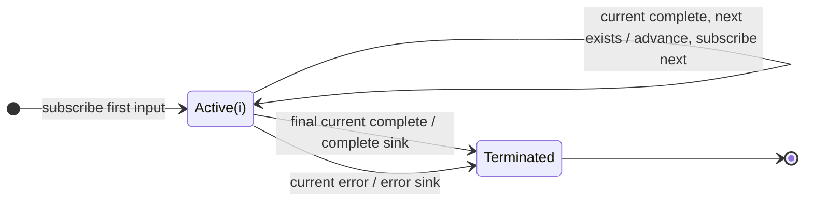

# concat

## Semantic essence

`concat` composes an ordered set of Observables by subscribing to exactly one at a time, forwarding that Observable's values unchanged, and advancing to the next Observable only when the current one completes.

## Classification

- Policy: sequential composition
- Memory: current participant index
- Active-source cardinality: 1
- Advancement: current completion
- Error: terminate

## Core BDD

```text
Given an ordered sequence of input Observables
When a downstream subscriber subscribes
Then subscribe to the first input
And keep later inputs pending

Given the current input is active
When it emits value v
Then emit v unchanged

Given another input remains pending
When the current input completes
Then subscribe to the next input

Given the final input is active
When it completes
Then complete the sink
```

## Mealy machine



## Domain DSL

`runInSequence(...)`

## Semantic fingerprint

**one active source + completion-gated cursor advancement**
