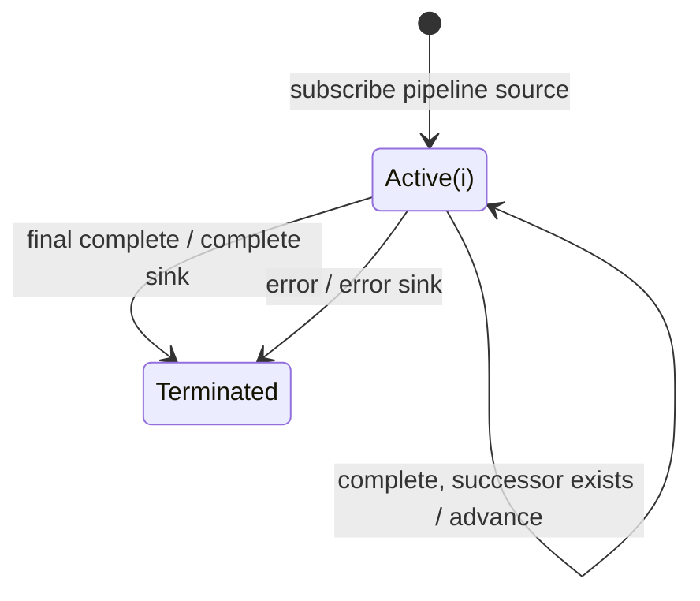

# concatWith

## Semantic essence

`concatWith` is the pipeline-source form of sequential stream composition. The pipeline source runs first; supplied successor Observables begin one at a time only after their predecessor completes.

## Core BDD

```text
Given a pipeline source and ordered successors
When subscribed
Then subscribe to the pipeline source
And keep successors pending

Given a current stream is active
When it emits
Then forward the value unchanged

Given another successor exists
When the current stream completes
Then subscribe to the next successor
```

## Mealy machine



## Domain DSL

`followedBy(...)`

## Semantic fingerprint

**pipeline source + ordered successors + one subscription at a time**
