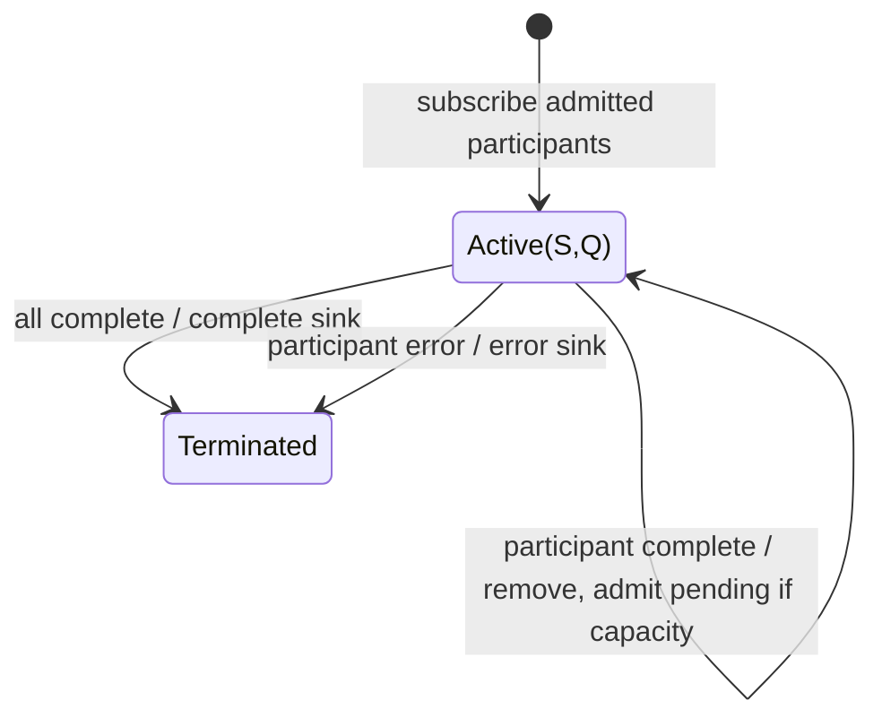

# merge

## Semantic essence

`merge` concurrently subscribes to participating input Observables up to its admission capacity and forwards every value from every active participant into one interleaved output.

## Classification

- Policy: concurrent interleaving
- State: active-subscription set, plus pending inputs when bounded
- Readiness: none
- Completion: all participants complete
- Error: immediate termination

## Core BDD

```text
Given participating inputs are active
When any input emits v
Then emit v immediately

Given multiple participants remain
When one participant completes
Then remove it from the active set
And continue the others

Given the final participant completes
When no active or pending participant remains
Then complete the sink
```

## Mealy machine



## Domain DSL

`interleave(...)` / `unifyEvents(...)`

## Semantic fingerprint

**active subscription set + immediate forwarding + all-complete termination**
