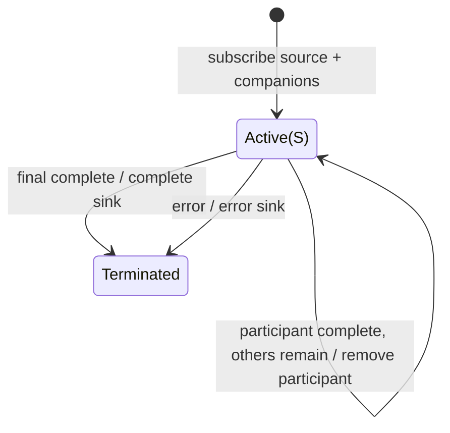

# mergeWith

## Semantic essence

`mergeWith` concurrently subscribes to a pipeline source and supplied companions, forwarding values from every participant as they occur and completing after all participants complete.

## Core BDD

```text
Given a pipeline source and companions
When subscribed
Then subscribe to all participants

Given any participant emits v
When that emission occurs
Then emit v immediately

Given one participant completes
When others remain active
Then remove only the completed participant

Given the final participant completes
Then complete the sink
```

## Mealy machine



## Domain DSL

`interleaveWith(...)`

## Semantic fingerprint

**pipeline participant form + concurrent interleaving**
