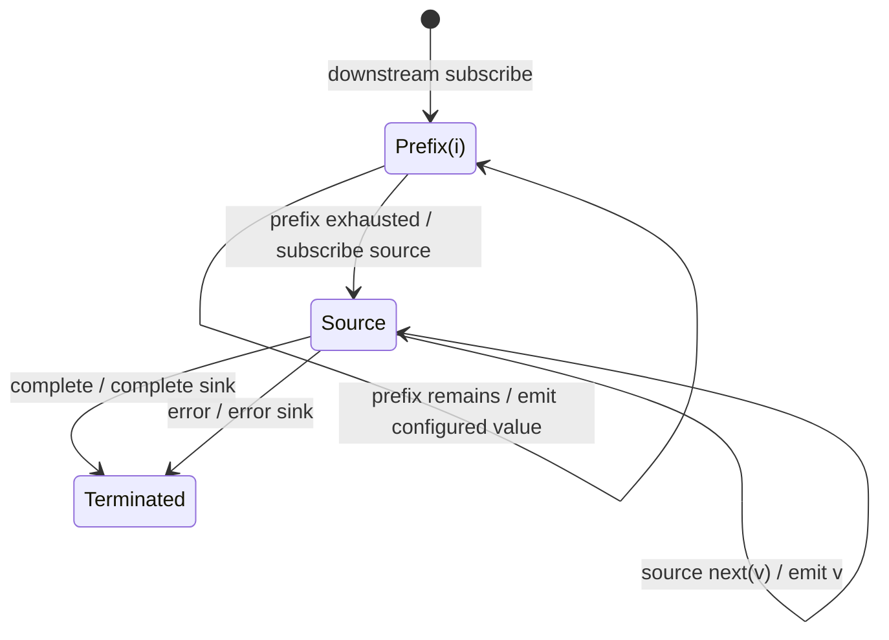

# startWith

## Semantic essence

`startWith` decorates the beginning of a source lifecycle by emitting a finite configured prefix in order before subscribing to and mirroring the source.

## Classification

- Policy: subscription-boundary prefix decoration
- Phase 1: configured prefix
- Phase 2: source
- Source notifications: mirrored

## Core BDD

```text
Given configured prefix values exist
When a downstream subscriber subscribes
Then emit the configured values in order
And after the prefix is exhausted subscribe to the source

Given the source is active
When it emits v
Then emit v unchanged
```

## Mealy machine



## Domain DSL

`initially(...)` / `prefixWith(...)`

## Semantic fingerprint

**subscription -> finite prefix -> source**
