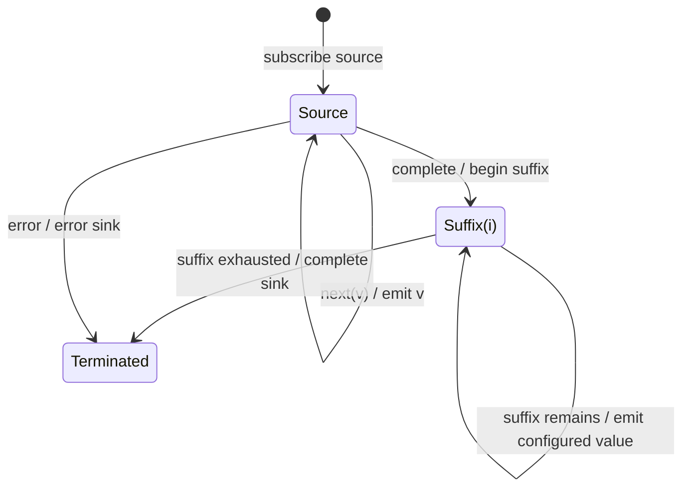

# endWith

## Semantic essence

`endWith` mirrors the source while it is active and decorates normal completion with a configured finite suffix before the result completes.

## Classification

- Policy: normal-completion suffix decoration
- Source next: forward
- Normal completion: activate suffix
- Error: propagate, no suffix

## Core BDD

```text
Given the source is active
When it emits v
Then emit v unchanged

Given the source is active
When it completes normally
Then delay sink completion
And emit configured suffix values in order
And complete after the suffix is exhausted

Given the source errors
Then error the sink without beginning the completion suffix
```

## Mealy machine



## Domain DSL

`completeWith(...)` / `suffixWith(...)`

## Semantic fingerprint

**source -> normal completion -> finite suffix -> completion**
