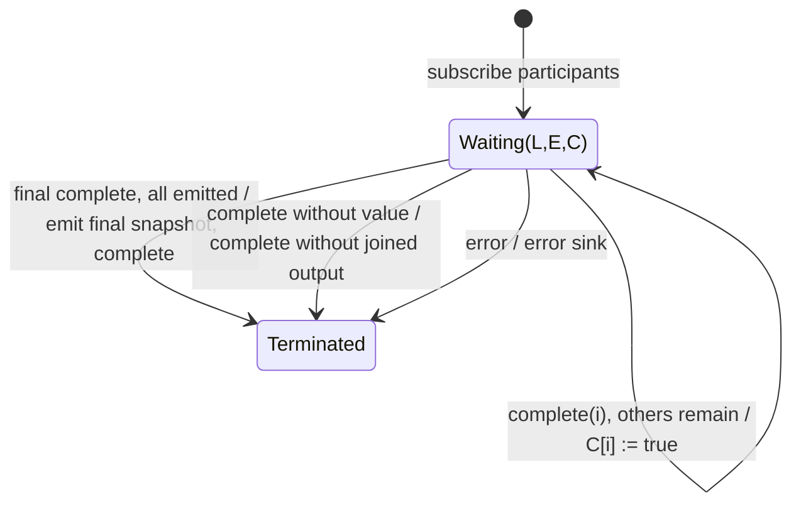

# forkJoin

## Semantic essence

`forkJoin` retains the last value from every participant and waits for every required participant to complete. If each participant has emitted at least once and completed, it emits one terminal snapshot and then completes.

## Classification

- Policy: completion-gated terminal join
- Memory: latest register + has-emitted flag + completion flag per participant
- Output cardinality: at most one
- Barrier: all participants complete successfully with values

## Core BDD

```text
Given participant i is active
When it emits value v
Then replace participant i's retained final candidate with v
And emit nothing

Given participant i has emitted
When it completes
Then mark participant i complete
And retain its last value

Given every participant has emitted and completed
When the final required completion occurs
Then emit the retained final snapshot
And complete the sink

Given a participant completes without a value
Then complete without a joined result
```

## Mealy machine



## Domain DSL

`whenAllComplete(...)`

## Semantic fingerprint

**latest register bank + all-complete barrier + one terminal snapshot**
