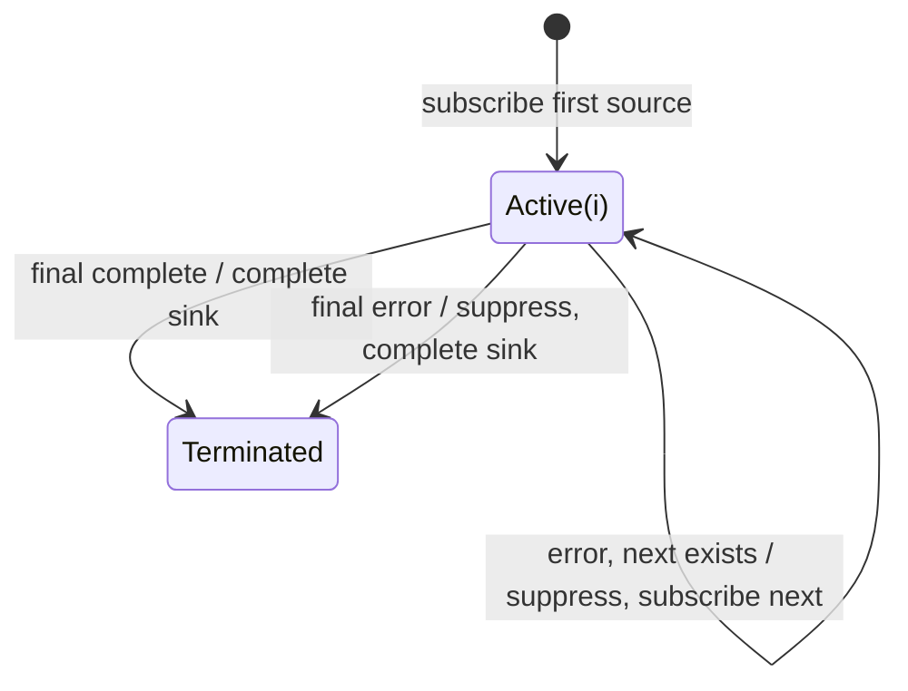

# onErrorResumeNext

## Semantic essence

`onErrorResumeNext` performs terminal-insensitive sequential continuation. It forwards one source at a time and advances to the next predefined source whether the current source completes normally or errors; source errors are suppressed from the result.

## Core BDD

```text
Given the current source is active
When it emits v
Then emit v unchanged

Given another source remains
When the current source completes
Then subscribe to the next source

Given another source remains
When the current source errors
Then suppress the error
And subscribe to the next source

Given the final source terminates by completion or error
Then complete the result
```

## Mealy machine



## Domain DSL

`bestEffortSequence(...)`

## Semantic fingerprint

**complete OR error -> advance; errors become invisible control-flow events**
