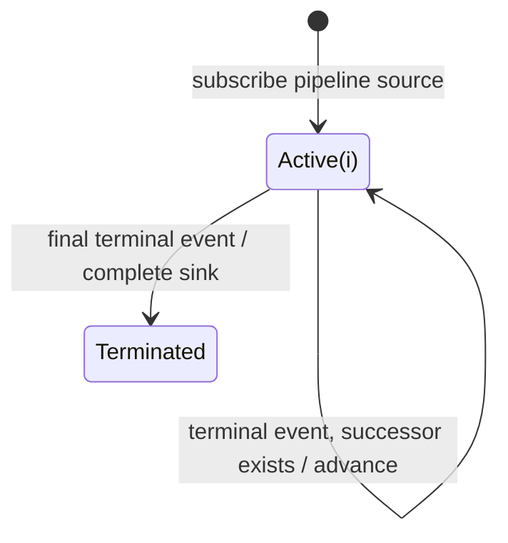

# onErrorResumeNextWith

## Semantic essence

`onErrorResumeNextWith` is the pipeline-source form of terminal-insensitive sequential continuation. The pipeline source and ordered successors are processed one at a time; completion or error both advance the cursor.

## Core BDD

```text
Given the current stream is active
When it emits v
Then emit v unchanged

Given a successor remains
When the current stream completes or errors
Then suppress any error
And subscribe to the next successor

Given the final stream completes or errors
Then suppress any final error
And complete the sink
```

## Mealy machine



## Domain DSL

`followedByBestEffort(...)`

## Semantic fingerprint

**pipeline sequence + terminal-event normalization + normal final completion**
