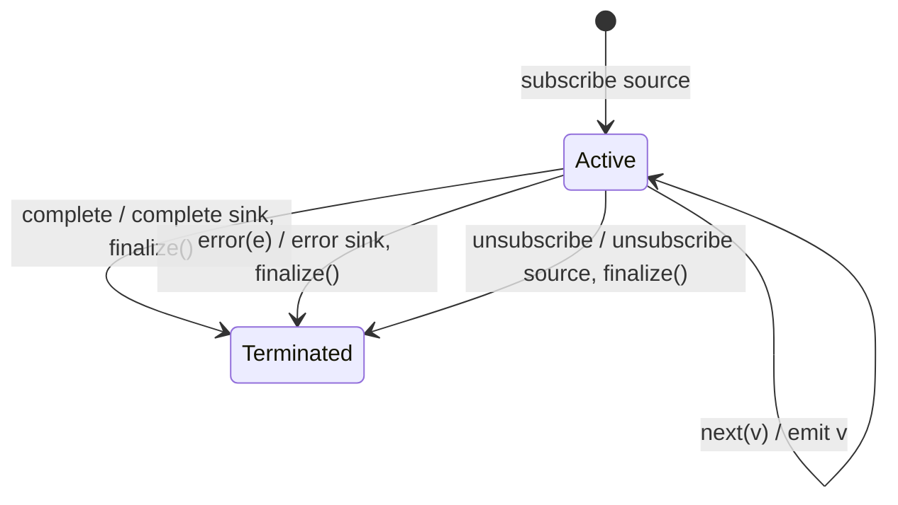

# finalize

## Semantic essence

`finalize` mirrors source notifications unchanged while attaching a callback to subscription teardown. The callback runs when the subscription terminates through normal completion, error, or explicit unsubscription.

## Classification

- Family: lifecycle observation
- Policy: teardown side effect
- Value transformation: none
- Triggers: complete, error, explicit unsubscribe
- Callback result: not part of the stream

## Core BDD

```text
Given the source subscription is active
When the source emits v
Then emit v unchanged

Given the source completes
When the subscription terminates
Then preserve normal completion
And invoke the finalize callback

Given the source errors
When the subscription terminates
Then preserve the error
And invoke the finalize callback

Given the downstream explicitly unsubscribes
When teardown occurs
Then unsubscribe the source
And invoke the finalize callback
```

## Mealy machine



## Domain DSL

`onTeardown(callback)`

## Semantic fingerprint

**notification-transparent source mirroring + teardown callback on complete/error/unsubscribe**
